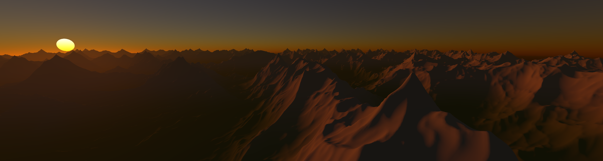
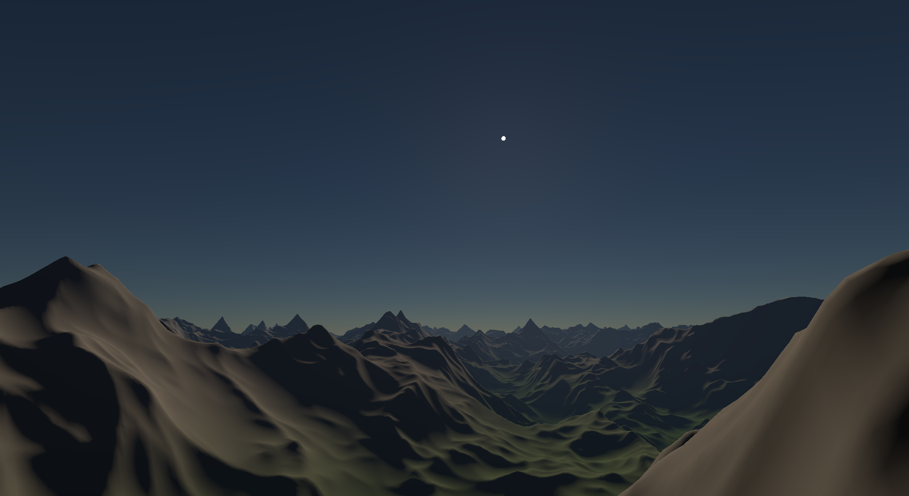
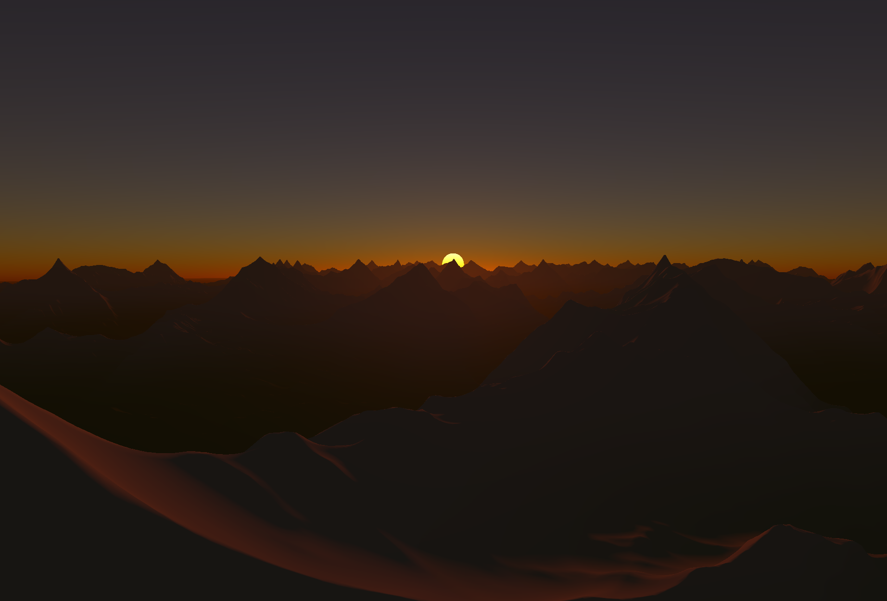
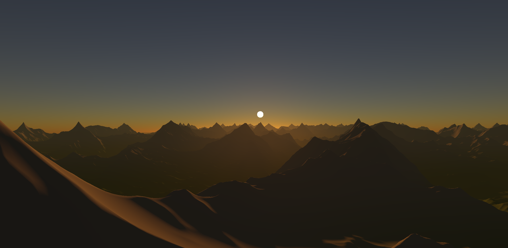
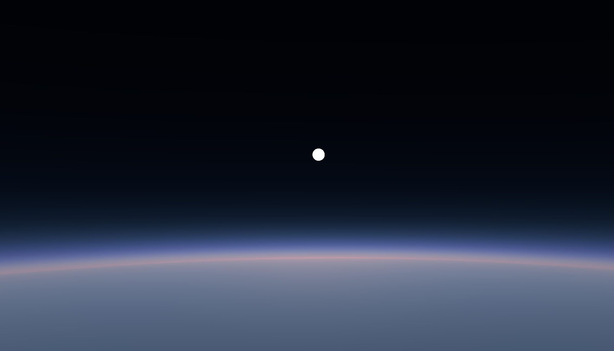

# AtmoGL - Projet POGLA

AtmoGL is a real-time atmospheric rendering project built with C++ and OpenGL.
It renders the sky, sunlight, and aerial perspective over a procedural mountain
landscape, using single scattering and GPU-computed look-up tables.

This project was created for the advanced OpenGL (POGLA) course at EPITA. It is
based on Sébastien Hillaire's paper
[A Scalable and Production Ready Sky and Atmosphere Rendering Technique](https://sebh.github.io/publications/egsr2020.pdf).

[Watch the presentation video](https://youtu.be/p67JqIY6LQ0).

## Features

- Rayleigh and Mie single scattering, with ozone absorption.
- Transmittance, Sky-View, and 3D Aerial Perspective LUTs generated with compute shaders.
- Sun disk and atmospheric attenuation of sunlight on the terrain.
- Procedural mountain terrain covering 50 × 50 km.
- HDR rendering with exposure, tone mapping, and sRGB output.
- Dear ImGui controls for the Sun, LUT debugging, and comparison between direct
  ray marching and LUT-based aerial perspective.

## Screenshots

<p align="center">
  
  <br>
  <em>Sunset over the procedural mountain terrain</em>
</p>

<table>
  <tr>
    <td align="center" width="50%">
      
      <br>
      <em>Daytime sky</em>
    </td>
    <td align="center" width="50%">
      
      <br>
      <em>Sunset colors</em>
    </td>
  </tr>
  <tr>
    <td align="center" width="50%">
      
      <br>
      <em>Aerial perspective across the landscape</em>
    </td>
    <td align="center" width="50%">
      
      <br>
      <em>Atmospheric horizon</em>
    </td>
  </tr>
</table>

## Requirements

- An OpenGL 4.3-compatible GPU and driver.
- CMake 3.20 or later.
- Visual Studio 2022 with C++ support for the Windows presets.
- vcpkg, with `VCPKG_ROOT` pointing to its installation directory.

Dependencies (GLEW, FreeGLUT, GLM, and Dear ImGui) are managed through `vcpkg.json`.

## Build and run

From the project root, in PowerShell:

```powershell
cmake --preset windows-msvc
cmake --build --preset windows-release
cd build/msvc/Release
.\AtmoGL.exe
```

Shaders are copied next to the executable during the build. Launch from that
directory so the application can find them.

## Controls

- `W`, `A`, `S`, `D`: move.
- `Q`, `E`: move vertically.
- `I`, `J`, `K`, `L`: rotate the camera.
- Left mouse button + drag: look around.
- `C`, `X`: increase or decrease movement speed.
- `Esc`: quit.
